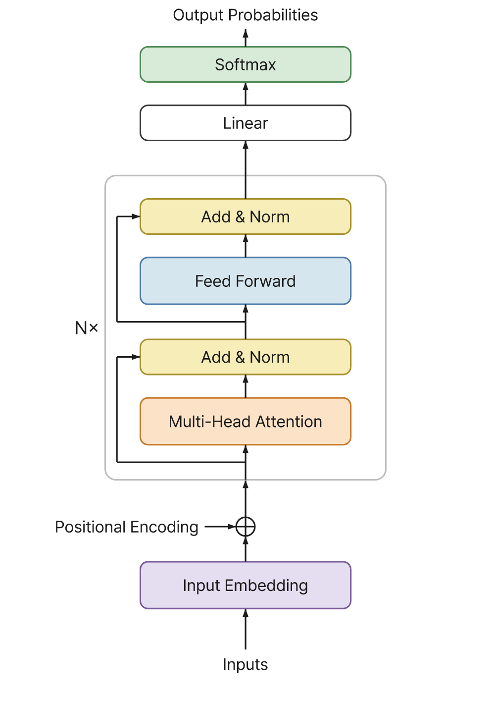

# DesignLLMTool

[한국어](README.ko.md)

DesignLLMTool is a Windows desktop design app with a built-in MCP server. AI agents (`Claude Code`, `Codex CLI`, `Gemini CLI`, `AGY`, `Claude Desktop`, `Cursor`, `VS Code`, and other MCP clients) use it to create and edit editable design artifacts while you watch in the app window.

## What it does

- **Artifact kinds**: `Canvas` (screens, landing pages, posters, social posts, paper architecture diagrams), `Slides` (saved as PPTX), `Figure` (data plots from CSV with evidence from PDF), `DOCX`, `HWPX`, and `HWP` documents, and `Web code`.
- **Exports and saves**: export to `PDF`, `SVG`, `PNG`, `PPTX`, `HTML`, and `ZIP` (web code); documents save in their native format.
- **Mandatory design guides**: the `design_guide` tool returns built-in guides. If an agent sends a change to an artifact before its connection has received that artifact's guide, that first change is refused with `GUIDE_REQUIRED`, and the refusal carries the guide. Once delivered, a guide also covers every other artifact on the same connection that uses the same guide (for example, every deck); calling `design_guide` with only a topic is reference reading and unlocks nothing. After each applied change to a `Canvas` or a deck, the result lists its design-quality warnings; if a warning belongs to another artifact (after a shared token change), it names that artifact. A design glossary (`design_guide` topic `glossary`) defines every design term used by the guides.
- **Paper architecture diagrams and data plots**: Architecture, pipeline, and method-overview figures follow the `paper-diagram` guide: use a `Canvas` at print size, include no title inside the figure, and use typed shapes (such as trapezoid encoders, cylinders, and `circle_plus` residual joins), orthogonal arrows, and `N×` repeat frames. The `design_guide` topic `paper-diagram-example` returns a complete Transformer encoder figure as one `changes_apply`. Data plots follow the `paper-figure` guide, using a `Figure` artifact, Okabe-Ito colours, and axis labels that include units. A diagram inside a `Figure` supports only rectangles, ellipses, math formulas, and straight connectors; draw elbows and typed shapes on a `Canvas`. A Figure output profile (single column, double column, print, or presentation) assigns the first colour of its palette to every plot panel, so the same series has the same colour in every panel. Later series follow the palette order (Okabe-Ito, with print and presentation starting with near-black), and the swatches in a common legend are recoloured to match their series. A `Figure` without a chosen profile keeps its earlier colours, except when a plot has two or more series and either its panel colour is in an output profile palette or a later series repeated the panel colour; that plot now receives the series colours of the current rule, and its visual approval must be given again.

  

- **Anti-generic design rules**: layout explains structure and auxiliary labels are left out. A coloured bar along the top or left edge of a card or box (the blog-callout look) is avoided unless requested and reported as `ACCENT_BAR`. Stock framework and assistant colours (Tailwind blue/indigo/emerald/red, Bootstrap, Material, Google blue, ChatGPT green, Claude orange, Gemini violet, dark navy surfaces) are reported by `COLOR_STOCK_DEFAULT` (always on a deck; on a `Canvas` once it uses a v1.2 value such as a corner radius, opacity, a shadow, a gradient, or a path, keeping older `Canvas` files' validation output unchanged). The built-in `Canvas` templates use no stock framework colours.
- **Diagram shapes**: in the editor's toolbox (left panel, `Tools` tab), a `Canvas` provides a `다이어그램 도형` / `Diagram shapes` group with encoder and decoder trapezoids, data (parallelogram), store (cylinder), add (circle with `+`), multiply (circle with `×`), branch (diamond), frozen module (hexagon), and tensor (cuboid). Agents add the same shapes as `path` nodes (`changes_apply`, `add_node`) using recipes from `designllm://shapes` or `design_guide` topic `shapes-json`; the `add.shape` GUI command does the same for a person or for `ui_command_run`.

## Requirements

- Windows 10 or 11, 64-bit.
- Git, to clone the repository (the ready-to-run build is in the repository; about 90 MB).
- Optional: Microsoft Word, only for opening a PDF as an editable DOCX copy.
- Optional: Microsoft Edge WebView2 Runtime (included in Windows 11), for the web-code preview.

## Install for AI clients

Clone the repository and run `install.ps1`:

```powershell
git clone https://github.com/KIMY0UNGGON/DesignLLMTool.git
cd DesignLLMTool
powershell -ExecutionPolicy Bypass -File .\install.ps1
```

`install.ps1` uses `release\DesignLLMTool-0.1.0-mcp-win-x64\DesignLLMTool.exe`, verifies that the executable starts, and registers the MCP server named `designllm` with every installed client among `Claude Code`, `Codex CLI`, and `AGY`. The installer does not run `gemini mcp add` because that command rewrites the entire Gemini settings file (including entries for other servers) and can report success without saving. For `Gemini CLI`, the installer instead prints the `mcpServers` entry to add to `%USERPROFILE%\.gemini\settings.json` (or `.gemini\settings.json` under `GEMINI_CLI_HOME` when that variable is set). Before adding that entry, check `gemini mcp list` because an extension can provide a `designllm` server. When `Codex CLI` runs through a batch shim and a path contains a character that `cmd.exe` would interpret, the installer instead prints a `[mcp_servers.designllm]` TOML entry together with the path to the Codex settings file that the client uses (`%USERPROFILE%\.codex\config.toml`, or `config.toml` in `CODEX_HOME` when that variable is set).

- The installer never removes or changes an existing registration, because the entry can hold settings the installer cannot restore and can come from a project's settings rather than the user's. A client that already has a `designllm` server keeps that entry; to register this copy, change or remove that entry in the client settings where it is defined, then run `install.ps1` again. After each registration, the installer reads the entry back and counts it as registered only when the entry runs this copy's `DesignLLMTool.exe`. If a client does not report clearly whether it has a `designllm` server, the installer leaves that client unchanged and reports it as not registered.
- A client whose server list cannot be read is left unchanged.
- For `Gemini CLI`, `Claude Desktop`, `Cursor`, and `VS Code`, it prints the configuration to paste: an `mcpServers` entry for the first three, and a `servers` entry for `VS Code`.
- It exits with code `1` when a requested registration fails.

Installer options:

- `-Project "<existing folder>"`: keep the workspace in that folder.
- `-Client claude|codex|gemini|agy|print`: register one client, or only print the configuration.
- `-Background`: tools run without opening the window.
- `-DryRun`: print the commands without running or changing anything.

After installing, restart the AI client and ask it to call the `design_guide` tool. If it answers with the design guide index, the connection works.

## Manual registration

Replace `<repo>` with the clone folder path.

Claude Code:

```powershell
claude mcp add --scope user designllm -- "<repo>\release\DesignLLMTool-0.1.0-mcp-win-x64\DesignLLMTool.exe" --mcp
```

Codex CLI (in PowerShell type `codex.cmd`, because PowerShell drops the bare `--` when it runs `codex.ps1`):

```powershell
codex.cmd mcp add designllm -- "<repo>\release\DesignLLMTool-0.1.0-mcp-win-x64\DesignLLMTool.exe" --mcp
```

AGY:

```powershell
agy mcp add designllm -- "<repo>\release\DesignLLMTool-0.1.0-mcp-win-x64\DesignLLMTool.exe" --mcp
```

For `Gemini CLI` (in `%USERPROFILE%\.gemini\settings.json`), `Claude Desktop`, and `Cursor` (`mcpServers` JSON):

```json
{
  "mcpServers": {
    "designllm": {
      "command": "<repo>\\release\\DesignLLMTool-0.1.0-mcp-win-x64\\DesignLLMTool.exe",
      "args": ["--mcp"]
    }
  }
}
```

VS Code (`.vscode/mcp.json`):

```json
{
  "servers": {
    "designllm": {
      "type": "stdio",
      "command": "<repo>\\release\\DesignLLMTool-0.1.0-mcp-win-x64\\DesignLLMTool.exe",
      "args": ["--mcp"]
    }
  }
}
```

## Server options

- `--mcp`: run as an MCP server over stdio. The desktop window opens on the first tool call so you can watch; set `background: true` on a call, or start with `--background`, to work without the window.
- `--project "<existing folder>"`: store the workspace in `<folder>\.designllm` and save native files to `<folder>\artifacts`. Without it, the workspace is `%LOCALAPPDATA%\DesignLLMTool\workspaces\default` (or the folder in the `DESIGNLLM_WORKSPACE` environment variable).

## Using the desktop app

To use the desktop app without AI, run `DesignLLMTool.exe` directly or pass a project folder:

```powershell
.\release\DesignLLMTool-0.1.0-mcp-win-x64\DesignLLMTool.exe
.\release\DesignLLMTool-0.1.0-mcp-win-x64\DesignLLMTool.exe --project "<existing folder>"
```

- **Switch interface language**: the app interface is available in Korean and English. On the home screen, open the workspace menu (the workspace name at the top left) and choose `한국어` or `English`. The choice applies at once and is saved in `.gui\settings.json` in the workspace.
- **Add diagram shapes**: on a `Canvas`, open the editor's toolbox (left panel, `Tools` tab), expand `다이어그램 도형` / `Diagram shapes`, and click or drag a tile onto the page.

## Build from source

For developers building from source:

```powershell
rustup toolchain install 1.93.1
cargo +1.93.1 build --release -p designllm-application
cargo +1.93.1 test -p designllm-bridge -p designllm-contracts -p designllm-canvas -p designllm-runtimes
```

The release build outputs `target\release\DesignLLMTool.exe`. Copy `target\release\DesignLLMTool.exe` over `release\DesignLLMTool-0.1.0-mcp-win-x64\DesignLLMTool.exe` to update the packaged build.

## Licences

Third-party licences and notices are in `release\DesignLLMTool-0.1.0-mcp-win-x64\THIRD_PARTY_LICENSES.txt` and `release\DesignLLMTool-0.1.0-mcp-win-x64\THIRD_PARTY_NOTICES.txt`. The Pretendard font is under the SIL Open Font License (`assets\fonts\OFL-Pretendard.txt`).
